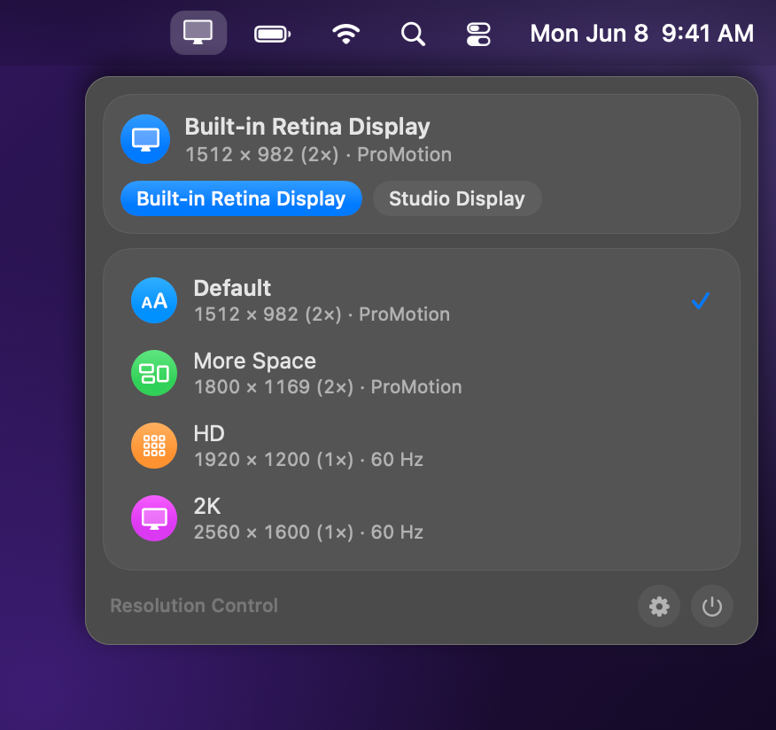
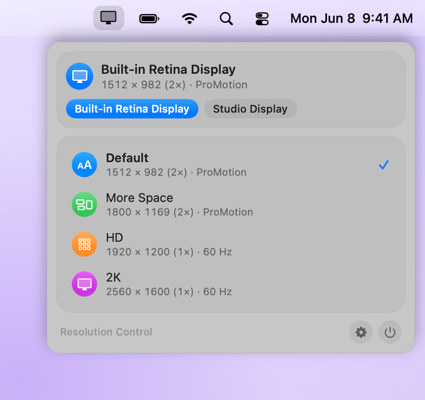
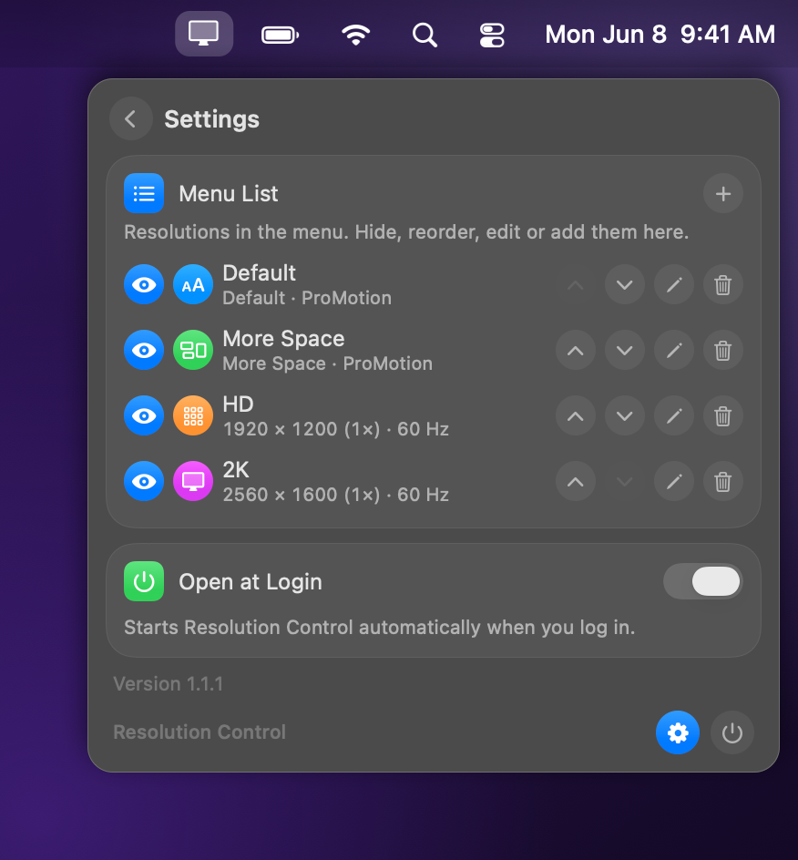
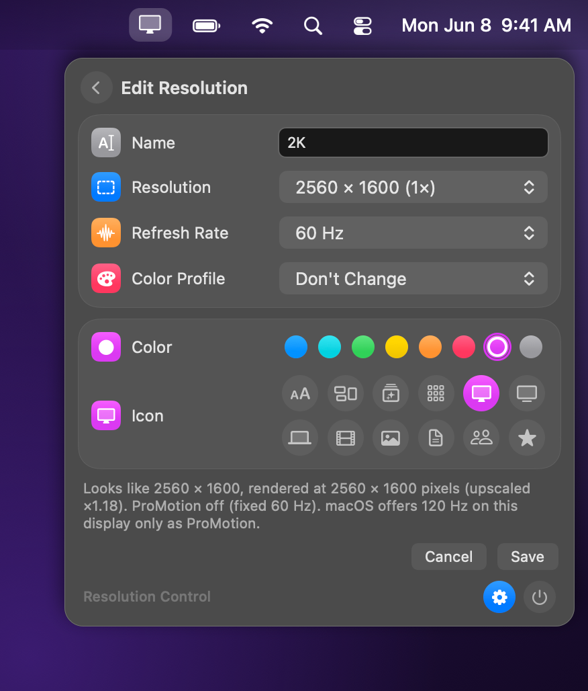

# Resolution Control

[](#requirements)
[](docs/DEVELOPMENT.md)
[](LICENSE)
[](#ai-assisted-development)

A menu bar app that switches your screen resolution, refresh rate and color profile from your own short list with one click.

<p align="center">
  
  
</p>

> [!NOTE]
> This app was developed with AI assistance. See [AI-assisted development](#ai-assisted-development).

## Features

- **Your own list**: entries with custom names; one click closes the menu and switches immediately. A check mark shows the active entry, each row shows size, render scale (2x Retina or 1x pixel-exact) and refresh rate.
- **Built-in entries**: Default and More Space follow Apple's choices for the display (ProMotion), HD is 1920 x 1200 at 1x and a fixed 60 Hz, 2K is 2560 x 1600 at 1x and a fixed 60 Hz. If a size is missing on another display, the most similar one is used (shown with "≈").
- **Editor**: pick any Retina or 1:1 mode the display offers, a refresh rate (ProMotion/highest or a fixed 60, 59.94, 50, 48 or 47.95 Hz) and a color profile (unchanged, factory or any installed RGB profile), plus a color and icon per entry.
- **Settings**: show, hide, reorder, edit, delete (a second click confirms) and add entries.
- **Several displays**: picker chips in the header; the list acts on the selected display.
- **Light on resources**: updates live without polling, no Dock icon, no network.

## Screenshots

<table>
  <tr>
    <td align="center"><br>Settings: hide, reorder, edit, delete and add entries</td>
    <td align="center"><br>Editor: resolution, refresh rate, color profile, color and icon</td>
  </tr>
</table>

## Requirements

- macOS 26 or later on Apple silicon

## Installation

1. Download `ResolutionControl-<version>.zip` from the [latest release](../../releases/latest) and unzip it.
2. Move **ResolutionControl.app** to `/Applications`.
3. Open it. The app is free and ad-hoc signed, not notarized by Apple, so macOS blocks the first launch:
   open **System Settings → Privacy & Security**, scroll down and click **Open Anyway**.
   Alternatively, in Terminal: `xattr -dr com.apple.quarantine /Applications/ResolutionControl.app`

The app starts at login by default; switch this off under Settings (gear icon) → **Open at Login**.
To uninstall, quit it from the menu and move it to the Trash. Resolutions and color profiles you applied stay as macOS keeps them.

## Usage

- Click the menu bar item and pick an entry to switch the selected display.
- With several displays, choose the display with the chips in the header first.
- Settings (gear icon): show, hide, reorder, edit, delete and add entries, and **Open at Login**. The editor shows a hint about sharpness (pixel-exact, integer or scaled) for the chosen mode.
- Limits: only modes macOS offers for the display; no custom timings, rotation, HDR presets or color depth. On built-in displays 120 Hz exists only as ProMotion (variable); fixed rates go up to 60 Hz.

## Build from source

```sh
brew install xcodegen
git clone https://github.com/ape97/ResolutionControl.git && cd ResolutionControl
./scripts/check.sh    # build + snapshots + self-test -> RESULT: GREEN
./scripts/deploy.sh   # check, install to /Applications, restart
```

No Apple developer account is needed. Project layout, scripts, signing, screenshots and releases are described in
[docs/DEVELOPMENT.md](docs/DEVELOPMENT.md).

## Permissions and privacy

Resolution Control needs no special permissions: no Accessibility, no Screen Recording, no administrator password and
no helper tool. Switching display modes and color profiles uses the public CoreGraphics and ColorSync interfaces, which
any app may call for the current user. It reads the list of installed color profiles from the standard ColorSync
folders. Changes are written to macOS the same way System Settings does, so they persist like any other display setting.

Everything stays on your Mac: no network access, no telemetry. The only stored data are your list and settings in the
app's user defaults.

## AI-assisted development

Resolution Control was built with the help of an AI coding assistant: code, comments, documentation and the screenshot
pipeline were written in collaboration with AI. Every change is built and checked with `scripts/check.sh`
(warning-free build, snapshots, self-test, performance test) and the app is in daily use on the maintainer's Mac.
Issues and pull requests are welcome.

## License

MIT, see [LICENSE](LICENSE).
